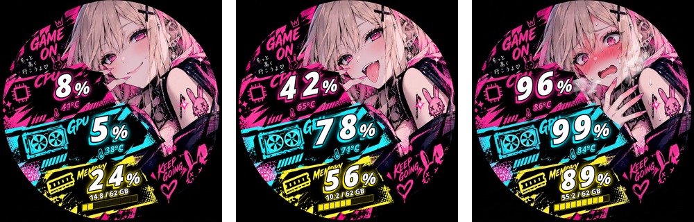

<div align="center">

# 🎮 Kraken Z53 水冷頭螢幕監控 — 霓虹電競少女 HUD

**[English](README.md) | [繁體中文](README.zh-TW.md) | [日本語](README.ja.md)**

專為 Linux 平台 **NZXT Kraken Z53**（`320x320` 圓形液晶螢幕）打造的街頭塗鴉風 **霓虹電競少女 HUD** 系統監控工具。支援預製超大號塗鴉數字圖集（Sprite Sheet）、依系統負載與溫度自動切換的三階段人物表情（`IDLE` ／ `GAMING` ／ `OVERHEAT`），以及底層 **雙槽位 Ping-Pong 零閃白** 硬體更新技術。



</div>

---

## ✨ 核心特色

- **🎨 三階段動態人物表情切換（含遲滯緩衝 Hysteresis）**
  依據即時 CPU / GPU 使用率與溫度自動切換角色神態，並內建進退場遲滯緩衝區間，防止在臨界點頻繁閃爍：
  - **🟢 `IDLE`（放鬆微笑）**：日常待機／低負載（使用率 `< 50%` 且溫度 `< 65°C`）
  - **🟣 `GAMING`（亢奮吐舌）**：遊戲進行中／中高負載（使用率 `>= 50%` 或溫度 `>= 65°C`）
  - **🔴 `OVERHEAT`（臉紅冒汗過熱）**：高溫滿載狀態（溫度 `>= 80°C` 或使用率 `>= 90%`）
- **⚡ 預製超大號街頭塗鴉數字圖集（Pre-baked Sprite Sheet）**
  離線烘焙 `1254x1254` 原畫比例的超大號斜體塗鴉數字（`assets/sprites/{cpu,gpu,mem}/`），具備濃黑外描邊、硬邊錯位色塊陰影與雙層噴漆霓虹外光暈。執行期僅需直接拼貼圖集，**CPU 運算負擔趨近於零**。
- **🛡️ 雙緩衝槽位 Ping-Pong 零閃白更新 & 智慧略過（Smart Skip）**
  徹底解決 `liquidctl` 預設寫滿 16 個記憶體槽位後觸發 `_delete_all_buckets()` 切回原廠白底畫面的「閃白」問題。固定僅在 **Bucket 0（`0 KB`）** 與 **Bucket 1（`512 KB`）** 之間原地交替更新；且當數值波動 `< 1%` / `< 1°C` 時自動略過 USB 寫入。
- **🔄 支援水冷頭安裝方向旋轉**
  支援 `--orientation {0, 90, 180, 270}`，完美適配各種水冷頭管線安裝角度。

---

## 📁 專案結構

```text
kraken-lcd/
├── kraken_monitor.py          # 主監控執行入口與 CLI 參數解析
├── config.py                  # 集中設定檔（尺寸、色彩、遲滯門檻、面板排版參數）
├── build_assets.py            # 離線資產與塗鴉數字圖集建置腳本
├── kraken-lcd.service         # Systemd 背景服務設定檔
├── install-service.sh         # Systemd 服務一鍵安裝腳本
├── run.sh                     # 手動啟動輔助腳本
├── requirements.txt           # Python 套件相依清單
├── monitor/
│   ├── collector.py           # CPU (psutil)、RAM 與 GPU (nvidia-smi / sysfs) 指標收集
│   ├── state.py               # 三階段表情狀態機（含遲滯緩衝）
│   ├── renderer.py            # HUD 預製塗鴉圖集拼貼與傾斜面板渲染引擎
│   └── device.py              # liquidctl 通訊與雙槽位 Ping-Pong 零閃白更新
├── assets/
│   ├── backgrounds/           # 三階段 1254x1254 高解析底圖 (idle, gaming, overheat)
│   ├── sprites/               # 預先烘焙的超大號塗鴉字元圖集 (cpu/, gpu/, mem/)
│   └── fonts/                 # 專案內建顯示字型
└── tests/                     # 單元與整合測試套件
```

---

## 🚀 快速開始

### 1. 環境需求
- Linux 作業系統，Python **3.10+**
- `libusb` / `hidapi`（供 `liquidctl` 與 NZXT Kraken Z53 水冷頭通訊）
- NVIDIA 官方驅動（`nvidia-smi`）或 AMD/Intel `hwmon`/`drm` sysfs 介面以讀取 GPU 資訊

### 2. 安裝步驟
```bash
git clone https://github.com/KAEDEKUKKI/kraken-lcd.git
cd kraken-lcd

python3 -m venv .venv
.venv/bin/pip install -r requirements.txt
```

### 3. 執行與預覽

```bash
# 預覽模式（僅輸出 320x320 PNG 預覽圖，不連線水冷頭硬體）
.venv/bin/python kraken_monitor.py --dry-run --output /tmp/kraken_lcd.png

# 強制指定特定人物表情狀態預覽 (idle / gaming / overheat)
.venv/bin/python kraken_monitor.py --dry-run --force-state overheat --output /tmp/overheat.png

# 實際連線 Kraken Z53 持續監控（每 3 秒更新一次，畫面逆時針旋轉 90°）
sudo .venv/bin/python kraken_monitor.py --loop --interval 3 --orientation 90
```

#### 命令列參數

| 參數 | 預設值 | 說明 |
|---|---|---|
| `--loop` | 關閉 | 持續循環更新，而非只輸出單張畫面 |
| `--interval <秒>` | `3` | 循環模式下的更新間隔（秒） |
| `--dry-run` | 關閉 | 將畫面輸出為 PNG，不傳送至水冷頭 |
| `--output <路徑>` | `/tmp/kraken_lcd.png` | 預覽模式的輸出路徑 |
| `--no-gpu` | 關閉 | 略過 GPU 偵測 |
| `--orientation {0,90,180,270}` | `0` | 旋轉畫面以配合水冷頭實際安裝角度 |
| `--force-state {idle,gaming,overheat}` | 自動 | 強制指定人物表情，停用自動切換 |

### 4. 部署為 Systemd 開機自動啟動服務
```bash
sudo ./install-service.sh
```
常用服務管理指令：
```bash
sudo systemctl status kraken-lcd.service
sudo journalctl -u kraken-lcd.service -f
sudo systemctl restart kraken-lcd.service
```

> [!NOTE]
> `kraken-lcd.service` 內的 `/home/kukki/kraken-lcd` 為預設路徑，`install-service.sh` 安裝時會自動替換成你實際 clone 的目錄。若要調整更新間隔或旋轉角度，請修改服務檔中的 `ExecStart`。

---

## ⚙️ 設定

所有可調整參數皆集中於 [`config.py`](config.py)：

- `STATE_THRESHOLDS` — `GAMING` / `OVERHEAT` 狀態的進入／離開門檻（使用率 % 與 °C），含遲滯緩衝
- `PANEL_CONFIGS` — CPU / GPU / MEMORY 各面板的位置、傾斜角度、字體大小、霓虹配色與光暈
- 顏色常數（`COLOR_PINK`、`COLOR_CYAN`、`COLOR_GOLD` 等）

## 🖌️ 重新產生素材

`assets/` 中已包含預先烘焙好的背景與數字 Sprite，**執行監控程式不需要任何建置步驟**。
`build_assets.py` 會從 `assets/backgrounds/_raw/` 的原始圖檔重新產生素材，但原始圖檔 **未包含在此儲存庫中**。若想重新產生或自訂美術素材，請自行放入原始圖檔後執行：

```bash
.venv/bin/python build_assets.py
```

---

## 🧪 執行測試
```bash
.venv/bin/python -m unittest discover -s tests -v
```
